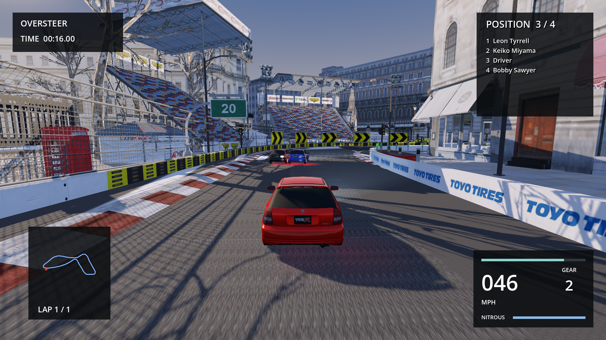
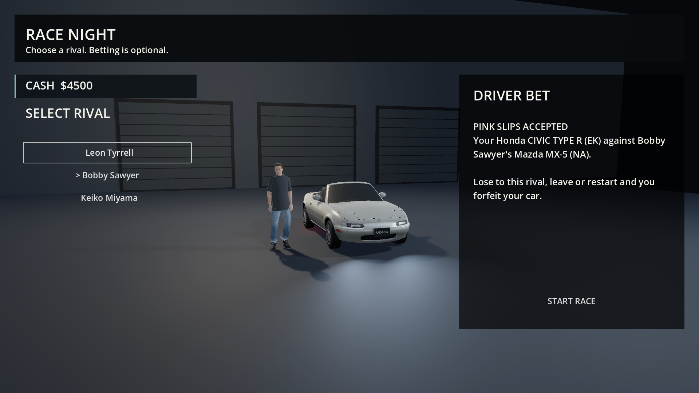
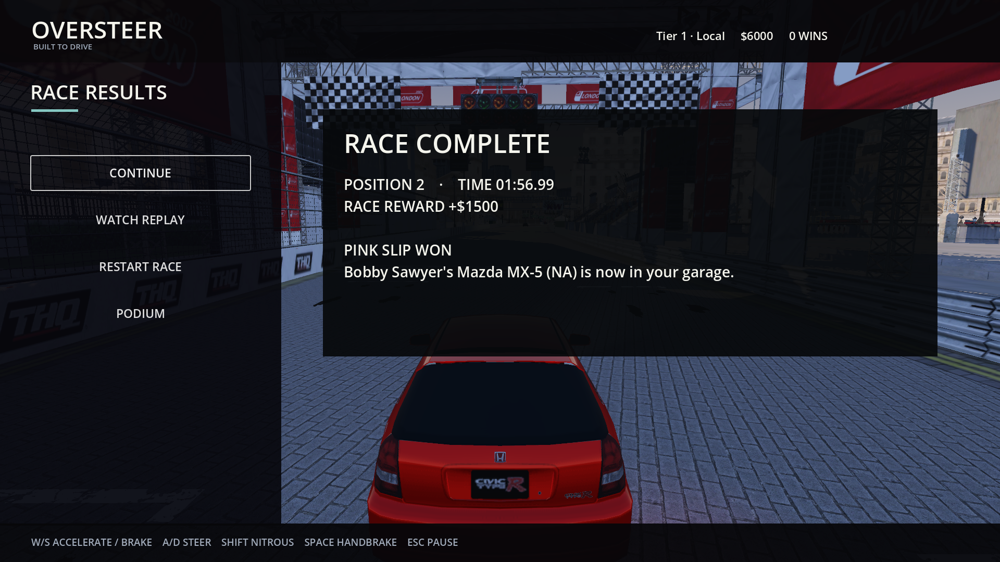

# Oversteer

**Build your garage. Put it on the line.**

An independent single-player racing game about street circuits, drifting and
the cars you earn along the way. Race for prize money, upgrade your ride, or
raise the stakes with optional cash bets and pink slips: your car against a rival's.

**In development for Apple Silicon Macs. No ready-to-play download yet.**



*Chasing two rivals into the next corner on London Circuit. Actual gameplay
capture with the normal driving camera and HUD.*

## Race. Build. Risk.

- **Chase the next tier.** Win circuit and drift events to open a promotion race.
  Take a quick race when you just want to drive.
- **Make a car yours.** Spend race earnings on cars, performance upgrades and
  paint. Start with a Civic; build a garage worth coming back to.
- **Pick your rival.** A bet is about beating that driver, even if you don't win
  the whole race. Win a pink-slip bet and their car joins your garage. Lose and
  yours goes. Betting is optional, and your last car cannot be staked.

## Your car against theirs



*Before the race: your Civic against Bobby Sawyer's MX-5. Lose to him and
you lose your car. Leaving or restarting also forfeits an accepted stake.*



*A completed pink-slip race: second across the line, but ahead of Bobby.
His MX-5 joins your garage.*

## Can I play it?

**This is a development build for Apple Silicon Macs, with no ready-to-play
download yet.** Running it requires a local build and prepared game assets;
those assets are **not included** in this repository. Cloning the repository
alone will not give you a playable game.

The current build has a 30-car roster, two London courses and six career tiers.
Visuals, handling and progression are still being refined; the screenshots show
the development build, including its unfinished visuals. See [what works and what's next](docs/game/PIVOT_STATUS.md).

## Build it locally

For setup, asset requirements, controls and packaging, start with the
[native game guide](docs/game/README.md). The game uses Rust and Godot 4.7.2
with gdext 0.5.5.

With the local assets prepared:

```sh
uv run --frozen python tools/game/bootstrap.py
uv run --frozen python tools/game/build.py run
```

To check the source without game assets:

```sh
uv run --frozen python tools/game/dev.py check
```

[Contributing](CONTRIBUTING.md) · [Project docs](docs/README.md) ·
[Design direction](docs/design/OVERSTEER_PIVOT_INTERVIEW.md) ·
[Screenshot provenance](docs/images/README.md)
