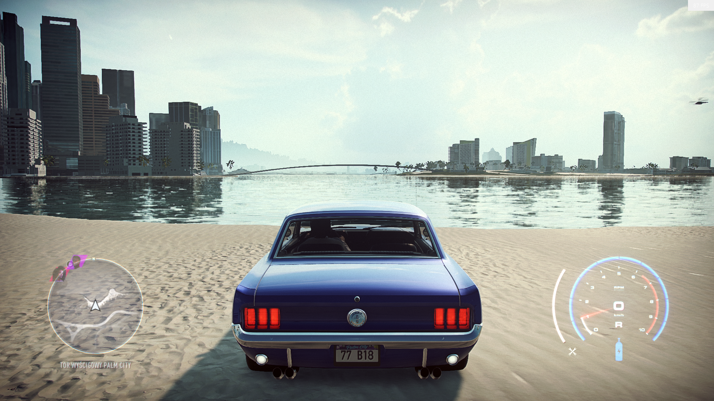
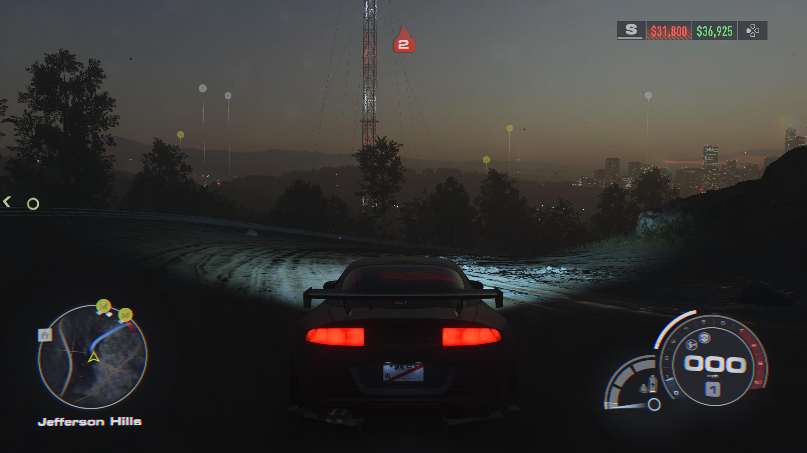
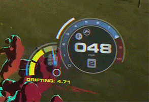
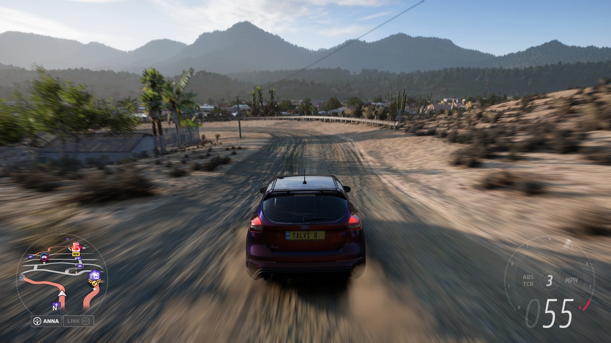

# Expressive racing HUD: art and rendering candidates

Research date: 2026-11-04. Scope: HUD art, fonts, vector/shader rendering. These are proposed treatments, not claims of implemented behavior or measured Metal performance. Keep physics, AI, rules and camera unchanged. Use actual snapshot RPM, gear, position and nitrous values. Godot 4.7.2 + gdext 0.5.5 remains the selected stack (ADR-0005); this work does not reopen it.

## Recommendation

Build an authored instrument, with open negative space, a distinctive tach silhouette, warm shift energy, and large condensed numerals. Add an ink-like route ribbon and brief cut-paper event flourishes. Shape, hierarchy and timing should establish identity before adding glow. Cyan can remain a secondary rival/navigation accent; it should not define every surface.

Discovery began with [Awesome Godot](https://github.com/Calinou/awesome-godot) and [Awesome Gamedev](https://github.com/Calinou/awesome-gamedev). Awesome Godot links Godot Shaders; the actual shader authors below supply executable primary code. An attempted `Awesome-GameDev/awesome-game-ui` URL returned 404 and supplied no evidence. Lists establish discovery, not compatibility. Source code and native API docs establish the following capabilities.

Jev screened fetched material before reading; all used batches passed. Jev ranked seven candidates by creative impact, legibility and implementation feasibility: typography .94, map .93, event stamp .92, open tach .90, custom MSDF art .90, nitrous .88, runtime SVG .45. Scores are relevance judgments, not benchmark results. The ranking below preserves that ordering; the recommended first visual milestone combines typography and tach because their silhouette must be judged together.

## Ranked implementation candidates

### 1. Oversized slanted numerals and a compact gear monogram

**Art proposal:** dominant ivory speed numerals, a small warm-white unit, gear in an independent red/orange cutout; outline and a restrained dark offset shadow give readable separation from road imagery. Position becomes an emphatic ordinal with a smaller field count, rather than another labeled rectangle. Use an actual italic face instead of skewing small text.

**Mechanism and evidence:** Godot's [native MSDF font rendering](https://docs.godotengine.org/en/stable/tutorials/ui/gui_using_fonts.html#msdf-font-rendering) permits large scaling without rerasterizing at each size. Keep small labels conventionally rasterized; MSDF loses hinting at small sizes. Its outline pixel range must cover at least twice the outline size. [Barlow Condensed's supplied license](https://raw.githubusercontent.com/google/fonts/main/ofl/barlowcondensed/OFL.txt) is SIL OFL 1.1: bundle its license with the font. Native font import is sufficient; no additional runtime library.

**Scope:** small: one font family, existing labels/resources, outline/shadow and layout. **Live check:** inspect changing 88→100→188 and gear transitions at the actual viewport, 720p and Retina scale; watch for clipped outlines and width jitter. Do not animate speed scale every frame.

### 2. A floating route ribbon with race information in the geometry

**Art proposal:** a dark wide silhouette beneath a fine ivory circuit line, a warm short highlighted player sector, a white directional player arrow and compact colored opponent marks. Distinct start/finish stitches and a subtle tapered player trail add function and craftsmanship. Shape follows the circuit; omit the surrounding dashboard slab.

**Mechanism and evidence:** [Line2D](https://docs.godotengine.org/en/stable/classes/class_line2d.html) draws a mesh polyline with gradients, textures, width curves and rounded joints. Two strokes supply separation from both bright and dark ground. Antialiased lines do not batch, so keep the geometry modest. Use map-space projected track coordinates and HUD-local transforms; a tilted presentation needs no gameplay camera change.

**Scope:** medium: track projection, separate markers, clipping and overlap handling. No new dependency. **Live check:** one lap including start seam and nearest rival pass; verify arrow orientation and race order against snapshots, plus sharp turns and track crossings. A beautiful incorrect map fails.

### 3. Cut-paper drift and position event stamps

**Art proposal:** a condensed word/ordinal arrives along an angled slash, catches with a short overshoot, holds briefly, then wipes away into a few streaks. Drift build-up can extend a brush-like underline; banked score gets one decisive impact. Use an original drawn motif and restrained animation frequency, not continuous wobbling.

**Mechanism and evidence:** [AnimationPlayer](https://docs.godotengine.org/en/stable/classes/class_animationplayer.html) supports animation libraries, transitions and nontrivial timed sequences. Layer original SVG/PNG shapes with text; animate transform, modulation and a simple reveal shader. These visual treatments are original proposals; the documentation establishes the animation facility, not their perceived quality.

**Scope:** medium: authored scene/timeline, event trigger/debounce and an interruption rule. No extra runtime library. **Live check:** closely spaced overtakes and a drift ending during another event; verify no hidden scores or animation pile-up. Preserve the road's center and the regular position display.

### 4. Open segmented tachometer with an independent speed block

**Art proposal:** a broad 230–250° horseshoe at bottom right, interrupted at the bottom and clipped asymmetrically at one shoulder. Ivory ticks progress through amber into hot red; a thin needle or hot leading segment supplies immediate RPM. Huge speed numerals occupy the opening; the gear floats beside the pivot. Avoid a full circle resembling a generic progress spinner.

**Exact reusable primary source:** Miisannn's [Circular Progress Bar](https://godotshaders.com/shader/circular-progress-bar/) is a `canvas_item` shader exposing progress, radius, thickness and rotation. Its posted code is explicitly CC0; preview imagery is excluded. It computes radius using `length(UV - 0.5)`, angle with `atan`, a smooth radial band and an angular progress mask.

**Adaptation proposal:** normalize angle over the chosen sweep, derive discrete sector index with `floor(angle / sector_width)`, mask each sector to roughly 80% duty, and antialias both edges. An authored static tick/number face can be imported SVG while the moving ring uses ShaderMaterial. Keep UV aspect correction explicit so a non-square display rectangle cannot turn the instrument into an ellipse unintentionally.

**Silhouette comparison:** a corner L is efficient but repeats the visual grammar of dashboard panels; an open horseshoe gives an immediately recognizable instrument and negative space. An eccentric interrupted crescent is more distinctive still, but needs actual rendered checks to prevent decorative complexity swallowing legibility.

**Scope:** medium: one shader, authored face and RPM/gear binding. No new runtime dependency. **Live check:** idle, redline, shift down/up, reverse and stationary throttle; compare ring endpoint with actual RPM. Check all shapes remain inside the current bottom-right safe area (approximately x1525–1855/y850–1015 at the parent's current viewport). These coordinates are task context, not independently measured here.

### 5. Custom MSDF chevrons and sharp badge art

**Art proposal:** bespoke sharp chevrons, split badges and angled event motifs with consistent outline thickness during short zooms. This is useful when standard imported SVG textures visibly soften at needed scale.

**Mechanism and evidence:** [msdfgen](https://github.com/Chlumsky/msdfgen) generates distance-field textures from vector shapes and glyphs, retaining sharp corners through multiple channels. It is [MIT licensed](https://raw.githubusercontent.com/Chlumsky/msdfgen/master/LICENSE.txt); its loader/export extensions use FreeType, TinyXML2 and libpng, with optional Skia. Run it offline, ship the resulting texture plus a small sampling shader, and avoid a native runtime extension. Native Godot MSDF font import already solves ordinary digits.

**Scope:** medium/high: asset conversion and custom shape sampling. **Live check:** a badge at 0.75×, 1× and 2× during reveal; inspect acute corners, contour bleeding and alpha edges. Defer until native assets show an actual quality limitation.

### 6. Nitrous as peripheral energy

**Art proposal:** a compact reservoir ribbon with animated diagonal flow, plus sparse warm or white streaks only at the outermost screen edges during active boost. The center stays transparent and the camera stays fixed to its existing behavior. A brief activation flare should communicate the state immediately without washing out cars or braking points.

**Primary code:** Melisek's [Speed lines](https://godotshaders.com/shader/speed-lines/) uses polar UVs, NoiseTexture2D and curve textures for fade and density. The posted shader code is CC0, excluding images/videos. Adapt the falloff curve to be exactly zero in the driving center and multiply opacity by actual boost activity. This is an overlay; screen sampling, blur and chromatic distortion are unnecessary.

**Scope:** small/medium: one shader, textures and boost binding. **Live check:** boost on a straight then a corner; ensure the effect turns off exactly with state, does not cover rivals, and has no center contamination at 16:9 or ultrawide. Compare shader-off/on GPU timings before accepting it.

### 7. Runtime vector-path rendering as an experimental branch

[Giwayume/godot-svg](https://github.com/Giwayume/godot-svg) is MIT and renders Godot 4.3 SVG curves with shaders on polygons. Its own README explicitly calls it early development, warns about self-intersection errors and solver freezes, and advises built-in SVG texture imports for most uses. Treat 4.7/Metal compatibility as unproven.

**Possible benefit:** zooming elaborate authored dials indefinitely. **Scope:** high and uncertain; addon plus compatibility/performance validation. **Live check:** a minimal copied project on the exact Godot/Metal build, then representative paths, before considering integration. This is lower priority than original assets and native shaders. [ThorVG's own support for SVG/Lottie](https://github.com/thorvg/thorvg) does not establish a Godot runtime Lottie API; do not claim that bridge exists without separate evidence.

## Verification boundary and first implementation slice

This research fetched actual code, API documentation and licenses. Jev verified seven batched factual capability/license claims: seven supported, none contradicted/unsupported, no review flags. It did not run shaders or assess pixels; no Godot/Metal compatibility, visual quality or frame-time claim is established by research alone.

Recommended first slice: #1 + #4, then #2. Preserve the existing snapshot/event boundary and camera. Use one representative race replay, capture one clear frame at rest and one short moving sequence containing redline/shift/overtake/boost; count those against the parent task's capture budget. Verify the driving center remains readable, hierarchy is evident at a glance, and animations terminate correctly. Measure the same replay with effects enabled/disabled. Only add #5 or #7 after a concrete native-path limitation appears.

## Visual evidence collected

Collected 2026-11-04 through live Firecrawl screenshots (`maxAge: 0`). Four page captures requested a 1440×1000 viewport; this is the capture request size, not independently inspected image metadata. Source images are linked directly rather than copied into game assets. Capture URLs are tool-returned signed URLs and may expire; durable source-page/image links accompany each.

### Circular shader author preview

- Type: Author-posted shader preview, not a game HUD.
- [Source page](https://godotshaders.com/shader/circular-progress-bar/) · [Source image/animation](https://godotshaders.com/wp-content/uploads/2025/07/Screenshot-2025-07-01-220258.png) · [Captured source-page screenshot](https://storage.googleapis.com/firecrawl-scrape-media/screenshot-d65bda55-ab58-4c98-9142-5fc6b15e73ab.png?GoogleAccessId=scrape-bucket-accessor%40firecrawl.iam.gserviceaccount.com&Expires=1794423068&Signature=Rg7B7eyry7G8dlLW%2FTvBUdDsEIXrDGQC5Gdx66A7PkowuqMApKxBDgsnVA2j1jSot%2FI4YXj3VkziUe7qUv%2F8rZJD6FYwv9yOStZm%2F%2FIc%2FjZ7ExGs52kPT45cd4gqHBdm%2Faa2FUpl8mc%2Fjy2FYUmOh%2BseTIofBeQ0yZovm2bKHV2ivNRHR0VXzTBc53LePEfzRg3CWZGzB6ppUJMspeJpPnldS69TLg0MXPdvkIVRf0TyOLMRwUMyQ6pxi4g%2BIPcUDM6IgG8UQ66MNFkaLHlEOpNlCnhg6MFc7S%2F0juOVr0o%2B3NhNPo6OI40fXASH60uKzu5m5vGuE8qFxBaKwy5RNw%3D%3D)
- Shows the ring mechanism used for the proposed tach; the open asymmetric instrument remains an original proposal.

### Speed-line shader author preview

- Type: Author-posted shader preview, not a game capture.
- [Source page](https://godotshaders.com/shader/speed-lines/) · [Source image/animation](https://godotshaders.com/wp-content/uploads/2021/01/Zrzut-ekranu-2025-01-06-232950.png) · [Captured source-page screenshot](https://storage.googleapis.com/firecrawl-scrape-media/screenshot-2242489e-a4e3-4231-8c9b-925a4d675831.png?GoogleAccessId=scrape-bucket-accessor%40firecrawl.iam.gserviceaccount.com&Expires=1794423058&Signature=be4I4aJqKX7mRC5nsm%2BnsGnXIF39%2BEZhnofTLK39N7HTnX2zP5MkkHAF94b%2FX21wVY3nZQQxZT7f5pvimhd%2B9IZ%2B5Gzp%2B2ndQH8202iLes5jao%2BnTXoNFYTxjT2gZcONNl4v6%2Bd8AskU0igO373hZnKknxBIn1ysgjMJ2aPq3aZ3nXh4VVHMV99jMoqvBCCwFknLMtnwEOFbfxpDyTWTQgV2tyvdtB%2BH3n%2FHjVBx%2Fhz0vOz8GA6isVLZ3C%2B4pnhIFCAAmTd4LqfeQcRgBbsV8pSLpstmVscmAgEhh2cInOpipVuZKhaF9yAHrgC0GVAB09N1S3meBkNpf1QgA5xKEg%3D%3D)
- Useful for peripheral boost energy; does not prove readability or comfort during a race.

### SuperTuxKart official gameplay screenshot

- Type: Source-owned game capture, gallery labels version 1.3.
- [Source page](https://supertuxkart.net/Gallery) · [Source image/animation](https://supertuxkart.net/assets/gallery/STK1.3_1.jpg) · [Captured source-page screenshot](https://storage.googleapis.com/firecrawl-scrape-media/screenshot-b335afe8-d5b6-43d7-9f18-3e8ecefdbed2.png?GoogleAccessId=scrape-bucket-accessor%40firecrawl.iam.gserviceaccount.com&Expires=1794423047&Signature=cPBaExN4dZ5HC0%2BHXWTv86ZxXpMzoK1TYI2fbkPNkNd1vzkpBdMtoGzQIk3nC6w1KX1tJuU2UVEcYuK7lgGDtFIGEmh2aInE0gUDk4%2BGQwdkcWJlln1rZDqwxIYuhzZ6RR%2FEcIT3CAK32XFPu24BNr8QvT8pxG%2BDP7zl3Oi8egyDHfx1ZiwnSfab0hyRevflCYWsuy2k5IUkJlxl8o6DLK28ZdNA6gLAMHG75iU0kss8JSk%2Fs62gQ1d%2BQfDKp%2BSOZyUglwxhspuyb49%2F55CQcSk8UHjZQUQXtNKAnmGvA28uvAwFdqnF%2B9FQmMs3xzAI6aD5SazVlyrB5tmQr2cKBQ%3D%3D)
- A concrete gameplay reference for judging how much screen area a playful racing HUD occupies; this research did not run that version.

### Segmented procedural circular shader

- Type: Author-posted animated shader preview, 150×150 derivative indicated by asset filename.
- [Source page](https://godotshaders.com/shader/procedural-circular-progress-bar/) · [Source image/animation](https://godotshaders.com/wp-content/uploads/2021/01/circular_progress_bar_uploading-150x150.gif) · [Captured source-page screenshot](https://storage.googleapis.com/firecrawl-scrape-media/screenshot-0491395c-00e9-44f9-a5b8-53857d582271.png?GoogleAccessId=scrape-bucket-accessor%40firecrawl.iam.gserviceaccount.com&Expires=1794423104&Signature=imRkkLgGGunVmzwRCZqIG1R0jdIrM5NOXUjEG1O7NbyJ9%2BRyOOADyDpk1X%2BWy1pK1W7dXmtBTO9hicp2dp0ZeM7%2BSrKHBGdp%2FOkIRxoUMkXqCBJyYzDSiP18h4ztIOAVP8QQpU%2FhQVqiBc6m7%2BSHXzzHgQlUi9UDIll2SwFYj0EhynTRAqbuKNrAbe4R2TLC1gkF9Ap9aanCE7MgeFg2dckUsLIVca6k%2FCTlLj%2BT%2FkHSed7lu6C4TP9zpOWXTHQGYIuAfXkndUlsRb5FCaMeE2AjbzEXPwm74%2BWKsCF9%2FyFwKh5KvmGbyvQO0v8h6nwPalMKEyuPaHpT6qR6GsQjBA%3D%3D)
- A more direct segmented-ring reference: page explicitly lists segment, radius, hollow-radius, rotation and gradient customization. Code is MIT, unlike the simpler CC0 circular shader; retain attribution.

The tool returned screenshot URLs for all four pages. Pixel inspection was unavailable in this subtask: the image URL reader could not render the shader image, and the attempted hidden in-app browser returned `Browser is not available: iab`. Therefore no screenshot transcript was invented or audited, and no assertion about visible pixel detail is verified. Jev screened the returned text/metadata; that does not verify pixels. Shader preview imagery is expressly excluded from the code's CC0/MIT grants. The SuperTuxKart gallery's screenshot redistribution license was not established here. These are reference links, not permission to redistribute imagery as product art.

## Three additional games: inspected HUD screenshots

Collected and inspected 2026-11-04. These are three distinct shipped-game references beyond DiRT Rally 2.0 and SuperTuxKart. This batch downloaded source images for visual analysis under the user's explicit screenshot request; no local game was launched. Images remain reference evidence, not reusable product art. Copyright/redistribution grants were not established.

### Need for Speed Heat — open instrument silhouette

- Provenance: secondary actual gameplay capture from [WSGF's Need for Speed Heat report](https://www.wsgf.org/dr/need-speed-heat/en), rather than publisher promotional photography.
- [Original full-size PNG](https://www.wsgf.org/f/u/contrib/dr/30137/ingame_16x9.png). Local: [nfs-heat-wsgf-hud.png](visual-evidence/nfs-heat-wsgf-hud.png), 1920×1080.
- Pixel inspection: a blue Mustang at a waterfront in daylight; circular minimap lower left; pale blue open horseshoe tach lower right, separate white outside arc to its left, speed/gear in the opening and a bottle below. The road center remains free.
- Transferable lesson: the incomplete ring and detached arc produce an instrument silhouette without a rectangle. The pale lines against bright sand also illustrate why Oversteer needs controlled dark separation beneath critical glyphs. This contrast assessment is visual judgment, not a measured accessibility claim.

### Need for Speed Unbound — an adjacent reservoir and state celebration

- Provenance: primary [Senior UI Artist Sailesh Vaghela's portfolio](https://saileshvaghela.com/nfsunbound). The designer identifies the HUD as his main area and explains the information/feedback intent. This is a designer-posted in-game HUD example plus an isolated animation extract, not an Oversteer mockup.
- [Original full HUD PNG](https://images.squarespace-cdn.com/content/v1/5697a24840667adbe8f82414/25e1ad92-1aa1-4094-8cd7-b670c4e8d58b/HUD_General.png). Local: [nfs-unbound-designer-hud.png](visual-evidence/nfs-unbound-designer-hud.png), 2500×1406.
- [Original full-boost GIF](https://images.squarespace-cdn.com/content/v1/5697a24840667adbe8f82414/9a83e453-5dbc-4ba0-9409-ba64b19ac2fe/Speedo_FullBoost.gif). Local [animation](visual-evidence/nfs-unbound-designer-fullboost.gif), 293×200, 387 frames; [inspected midpoint frame](visual-evidence/nfs-unbound-designer-fullboost-mid.png), zero-based frame 193. No video timestamp is asserted.
- Pixel inspection: huge 000 speed and gear inside a circular tach; a separate segmented quarter-circle reservoir attaches to its left, creating a recognizable compound silhouette. The inspected animated extract shows the gauge during driving with a yellow/green reservoir and drift text below.
- Transferable lesson: make the base instrument calm, then promote accent colour and annotation when a meaningful state changes. The designer explicitly discusses boost/damage/score/multiplier celebration and a full-boost colour change. Keep the secondary reservoir distinct from the RPM sweep so state is recognizable through shape as well as colour.

### Forza Horizon 5 — digital hierarchy and route contrast

- Provenance: secondary gameplay screenshot in [Nickie Harper-Williams's Game Accessibility Nexus review](https://www.gameaccessibilitynexus.com/blog/2022/03/01/deaf-hoh-review-forza-horizon-5/), explicitly captioned as the author's personal HUD setup. It is not a neutral default-settings claim or an official publisher capture.
- [Original JPG](https://www.gameaccessibilitynexus.com/wp-content/uploads/2022/03/Forza-Horizon-5-DHoh-04.jpg). Local: [fh5-nexus-hud.jpg](visual-evidence/fh5-nexus-hud.jpg), 1920×1080.
- Pixel inspection: a hatchback on a dirt road; lower-right tach is very faint, speed 055 is large below it with the leading zero dimmed, gear 3 is above, MPH to its right, a pink/red high-RPM segment on the edge. Lower-left map uses a broad salmon route on neutral roads, a white directional arrow, and ANNA/LINK buttons below.
- Transferable lesson: vary emphasis inside a number and between information classes. Route colour and thickness distinguish the path, while the tach skeleton can recede behind speed and gear. Avoid copying the extremely low-contrast dial treatment without testing Oversteer's backgrounds.

### Evidence handling and ranked lessons

All fetched source text used here passed Jev screening. A dense transcript was produced from `view_image` inspection of all three full HUD images and the Unbound animation midpoint, then screened and audited. Jev audited three extracted summaries against that transcript: all passed, maximum error signal .47; this only checks textual consistency, not independent agreement with the pixels. The designer's event/colour-change explanation was separately verified against his page (supports .99). Jev ranked the concrete lessons: Heat open horseshoe/outer arc .91, Unbound reservoir/event accent .87, FH5 typography/route hierarchy .87. These are relevance judgments, not objective beauty scores.

The earlier blocked pixel-inspection note applies to the first shader/STK batch only. This later three-game batch was actually inspected through local source downloads. A guessed WSGF Horizon 5 report returned a missing page and was discarded; the accessibility-review screenshot above supplies the successful third game.
